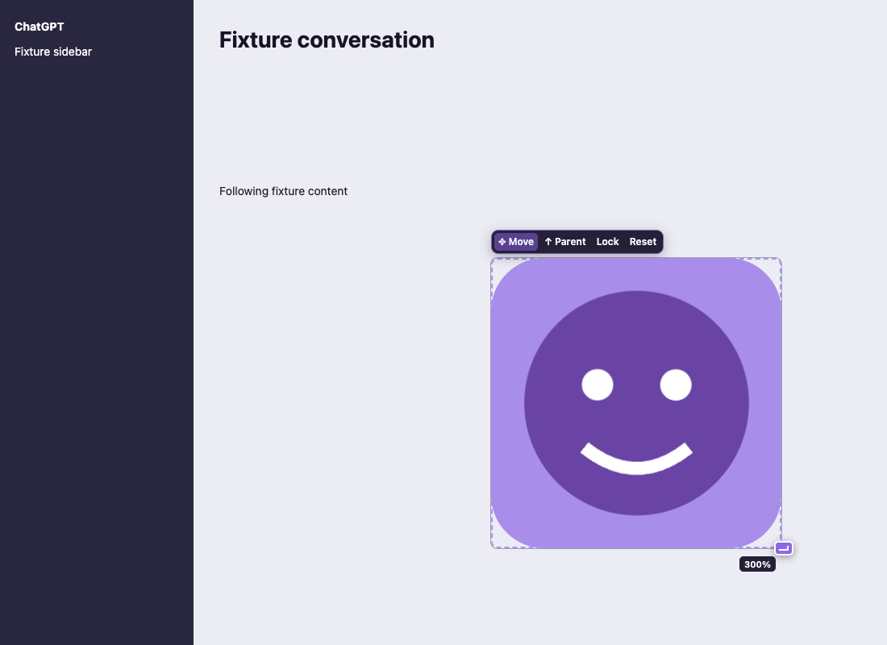

# Dot Pet Dock

Give your ChatGPT Dot pet more room: enlarge it **50–500%**, move it with an
explicit handle, then lock it in place. A small, local-only Chrome Manifest V3
extension with no build step, account, server, or API key.

**v0.3.0 compatibility:** tested as an actual unpacked extension in Chromium
against SVG/canvas/CSS-sprite fixtures, and against a live production Dots pet
in Chrome on October 16, 2026. The production adapter recognizes the pet avatar
and its native button overlay; the nametag keeps its original display size.
ChatGPT's private DOM can change. See [validation evidence](docs/validation.md).

## Install or update

Requires Chrome 120 or newer. This affects **chatgpt.com in Chrome**, including
Chromium-based browsers that support unpacked extensions. It cannot change the
native ChatGPT app's floating pet window.

1. Download **Code → Download ZIP** from this repository and extract it into a
   permanent folder, or clone the repository.
2. Open `chrome://extensions` and turn on **Developer mode**.
3. Choose **Load unpacked** and select the folder containing `manifest.json`.
4. Pin Dot Pet Dock to the toolbar, then reload your ChatGPT tabs.

To update, replace the files in the same folder (or run `git pull`), click the
extension's **Reload** button in `chrome://extensions`, and reload ChatGPT.
Unpacked extensions do not update automatically. If using a pull request branch,
check it out before loading the folder.

## Use

1. Open ChatGPT with the pet visible. A supported Dots avatar or uniquely marked
   pet frame can be detected automatically. Otherwise open the extension popup and use **Find pet
   automatically**, or **Pick pet on page** and click the artwork.
2. Check the outlined frame. Use **↑ Parent** if only part of the pet moved.
   Broad conversation, sidebar, and editor containers are rejected. **Esc**
   cancels selection.
3. Adjust the popup's size slider, or drag the purple corner. Drag **✥ Move** to
   reposition. Controls stay within reach at viewport edges.
4. Check **Lock in place** in the popup, or click **Lock** on the page. The pet
   remains visible and keeps its native pointer interactions. Uncheck **Lock**
   in the popup to edit again.
5. **Restore original display** restores owned website styles and removes the
   dock. It also stops automatic attachment on later reloads until you select
   or find a pet again.

For a supported Dots pet, **Wave** and **Jump** on the dock play the native
animation once. The extension popup offers an icon for each of the nine clips,
including while locked. Click an icon to play immediately; hover to see its name.
Playback returns automatically to live activity after the clip. This previews
the existing artwork without changing ChatGPT's working/status state. Playback
stops when the tab is hidden, the selected renderer disappears, or you Reset.
Unsupported sprite layouts keep animation controls disabled.

Position, size, and lock settings are shared across conversations and saved in
Chrome's local extension storage. One display is remembered at a time. If the
pet is absent, settings wait for it to return; Reset remains available.

Keyboard: **Alt + Shift + P** toggles selection. Focus **Move** and use arrow
keys to move 10 pixels. Focus the resize corner and use arrows to adjust size
10%. The popup slider supports 1% increments.



Screenshot: a local test fixture, not the authenticated ChatGPT interface.

## Rendering, privacy, and recovery

- The original HTML pet frame enters Chrome's **top layer** as a nonmodal manual
  popover. It stays under its original DOM/React parent. It can escape transformed
  ancestors, clipping, and stacking contexts without cloning the pet or changing
  the page's scroll position. An inert placeholder preserves an in-flow slot.
- CSS `zoom` enlarges the live renderer while leaving the site's `transform`,
  individual `scale`, `translate`, and `rotate` intact. Native SVG and canvas
  animation continue in the fixture tests. SVG can render sharply at the new
  size. CSS enlargement cannot add missing bitmap pixels to a canvas, sprite,
  image, or WebGL framebuffer. The extension does not alter canvas backing
  dimensions, WebGL state, or the pet assets.
- Recovery validates a unique visual identity, using stable IDs/test IDs and
  guarded hierarchy paths. A unique semantic pet marker can recover a changed
  wrapper. Ambiguous or unsafe matches wait for manual selection.
- Only child-list mutations are watched across the document; style observation
  is limited to the selected node. Geometry tracking runs only while editing.
  A separate three-second runtime validity check performs best-effort cleanup
  after disabling/reloading the extension. **Reload ChatGPT after disabling or
  uninstalling** to guarantee removal of old content scripts.
- Only `storage` and `activeTab` permissions are requested, and content scripts
  run on `https://chatgpt.com/*` only. No analytics, remote code, external API,
  chat text extraction, screenshots, cookies, credentials, or artwork are read
  or stored by the extension. Saved data contains target-identification
  metadata, position, scale, and lock state. Browser test profiles are temporary
  and never use a personal browser profile.

## Known limitations

- Production validation covers one Dots CSS-sprite layout in Chrome. Other
  layouts and future DOM changes may require an adapter update. Automatic
  detection waits when multiple eligible pet frames are present.
- SVG elements themselves cannot enter the popover top layer; selection promotes
  a small HTML parent. If no safe parent exists, selection is rejected. Existing
  website popovers and broad UI containers are deliberately left alone.
  A clickable pet frame is supported when it has a pet semantic hint. The
  production Dots avatar also supports its single native overlay button;
  frames with additional controls and ordinary unmarked buttons are rejected.
- Open Shadow DOM can be searched. Closed Shadow DOM is unsupported. Iframes
  can be selected only at their outer boundary; inner cross-origin content is
  not inspected. A pet whose renderer stops when out of flow/intersection may
  require a site-specific adapter after live investigation.
- Native modal dialogs/fullscreen content may cover the dock. Large pets can
  extend beyond a small viewport, while handles remain reachable. Moving and
  resizing can temporarily cover controls; lock it somewhere convenient.
- Settings are local to this browser/profile, with no cloud sync. Changes in
  another open tab are applied on the next reload rather than broadcast live.
- v0.1 settings migrate only when the current route's old selector identifies a
  unique, safe visual target. Otherwise select the pet again.

## Test

Python 3.10+ and Node.js (for syntax checks):

```bash
python3 -m venv .venv
source .venv/bin/activate
python -m pip install -r requirements-dev.txt
python -m playwright install chromium
python tests/smoke_browser.py
node --check targeting.js
node --check animations.js
node --check content.js
node --check popup.js
```

Linux CI installs Chromium's system dependencies with
`python -m playwright install --with-deps chromium`. The GitHub Actions workflow
runs these checks. To run one browser case, use `--test clipped` (the runner lists
available names for an unknown test name). `CHROME_EXECUTABLE` can select a
compatible Chromium binary; use Playwright's bundled Chromium for reproducible
unpacked-extension support.

Twenty-eight tests load the **actual unpacked MV3 extension** in isolated temporary Chromium
profiles and fulfill all ChatGPT fixture requests locally. They exercise content
script matching, real extension storage, popup messaging, selection and parent
selection, drag/resize, native animation/styles, lock/reset, reload/remount/SPA,
viewport recovery, clipping, SVG/canvas, and safe failure without a pet. These
are simulated pages; separate live checks are described in the validation notes.
One additional browser regression controls storage-response latency to check
that early page events cannot override a saved Reset before initialization.

For live verification, use a non-sensitive Dots page: pick the whole pet frame,
enlarge to 300–500%, move and lock it, test native pet interaction and ordinary
ChatGPT controls, navigate between conversations, reload, unlock, and Reset.
Confirm that artwork animation and default layout return correctly. Report
only renderer/container metadata and observed behavior; do not share chats,
cookies, credentials, or a browser profile.
